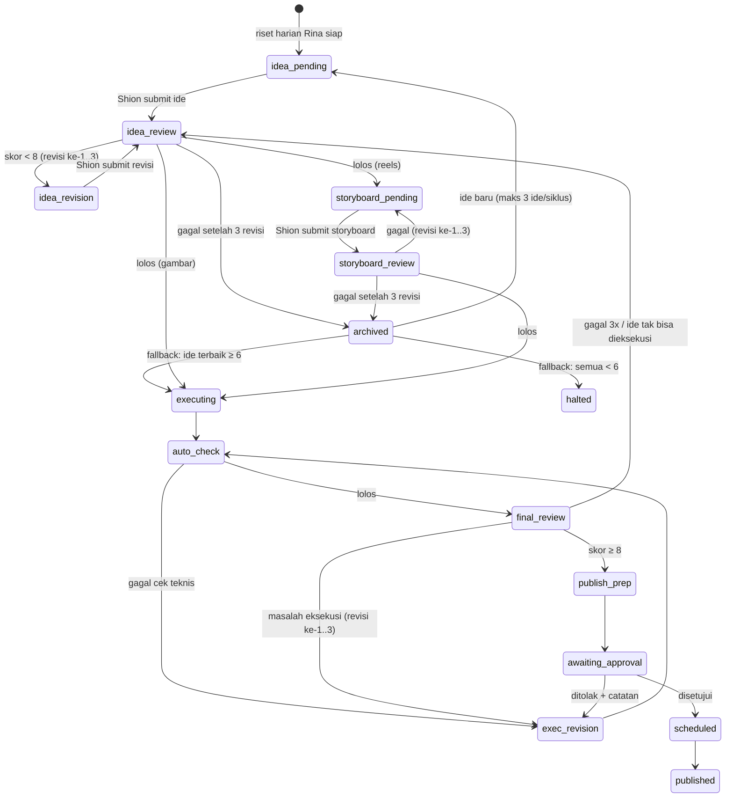

# Ryuartistry Studio — Dokumen Desain

Status: **Draf v0.4** (Fase 0–2 diimplementasikan, lihat [docs/setup.md](setup.md)) · Terakhir diperbarui: 2026-11-16

Studio konten otomatis berbasis multi-agen. Agen-agen AI bekerja dalam siklus riset → ide → review → eksekusi → review → publikasi. Mereka terhubung lewat **MCP server milik sendiri (`ryuartistry-studio`)** yang menjadi "kantor": antrian kerja, aturan, dan arsip.

Dua lini produk awal:

| Lini | Platform | Output |
|---|---|---|
| **Gambar** | Adobe Stock | Gambar stok AI (aset pembantu editing, background, tekstur, ilustrasi konsep, dll.) |
| **Reels** | Facebook Pro | Video vertikal pendek 30–60 detik |

---

## 1. Tim Agen

| Agen | Peran | Model | Input | Output |
|---|---|---|---|---|
| **Rina** | Riset pasar & tren | Claude + Grok | Sumber web, berita, tren X, data performa | Laporan riset harian + rollup mingguan/bulanan/tahunan |
| **Shion** | Pembuat ide/skenario | ChatGPT | Riset Rina, catatan ide yang dibuang, feedback | Brief ide (gambar) atau naskah + storyboard (reels) |
| **Lukas** | Reviewer ide | Claude | Brief ide + rubrik ide | Skor, keputusan lolos/revisi, saran perbaikan |
| **Linda** | Eksekutor | Gambar: Gemini / GPT Image · Reels: Claude | Brief yang disetujui + feedback | Aset final (gambar/video) |
| **Kechlyn** | Reviewer akhir, manajer & persiapan publikasi | Gambar: Claude · Reels: lihat §12 | Aset + brief + rubrik aset | Skor, diagnosis kegagalan, metadata publikasi |

Prinsip:
- **Pembuat dan penilai berbeda model** jika memungkinkan, supaya penilaian tidak bias terhadap karya sendiri.
- **Setiap penilaian wajib memberi masukan konkret** kepada eksekutor, bukan cuma skor.
- **Penilaian memakai rubrik tertulis** (§7) yang dibaca reviewer dari server, bukan "selera" model.
- **Aturan alur (batas revisi, routing, threshold) ditegakkan oleh server**, bukan oleh agen. Agen hanya mengirim hasil; server yang memutuskan langkah berikutnya.

---

## 2. Arsitektur

```
 ┌───────────┐ ┌───────────┐ ┌───────────┐ ┌───────────┐
 │ Claude    │ │ ChatGPT   │ │ Grok      │ │ Gemini/GPT│   ← klien AI (host MCP)
 │ (Rina,    │ │ (Shion)   │ │ (Rina)    │ │ (Linda    │
 │ Lukas,    │ │           │ │           │ │  gambar)  │
 │ Linda     │ │           │ │           │ │           │
 │ reels,    │ │           │ │           │ │           │
 │ Kechlyn)  │ │           │ │           │ │           │
 └─────┬─────┘ └─────┬─────┘ └─────┬─────┘ └─────┬─────┘
       └─────────────┴──────┬──────┴─────────────┘
                            │  MCP (Streamable HTTP, token per peran)
                ┌───────────▼────────────┐
                │ ryuartistry-studio     │  Next.js
                │  • MCP endpoint        │
                │  • State machine job   │
                │  • Rubrik & aturan     │
                │  • Dashboard (manusia) │
                └───┬───────────┬────────┘
                    │           │
              ┌─────▼────┐ ┌────▼─────┐
              │ Postgres │ │ S3       │
              │ (state,  │ │ (aset,   │
              │ riset,   │ │ draf,    │
              │ review)  │ │ final)   │
              └──────────┘ └──────────┘
```

Komponen:
- **MCP server** di dalam aplikasi Next.js ini. Setiap agen mendapat **token per peran**, dan server hanya membuka tools yang relevan untuk peran itu (Shion tidak bisa `submit_review`, dsb.).
- **Postgres**: semua state job, riset, review, revisi, performa.
- **S3**: aset (gambar mentah, hasil upscale, klip, video final, thumbnail). Dependensi `@aws-sdk/client-s3` dan presigner sudah terpasang.
- **Dashboard**: antrian approval manusia, monitoring status, biaya, dan performa.
- **Scheduler**: memicu agen sesuai jadwal (riset 3x sehari, pengecekan antrian). Fase awal memakai fitur scheduled task di aplikasi masing-masing AI; langkah yang paling sering jalan dapat dipindah ke pemanggilan API tanpa mengubah MCP server (§13).

Pola kerja agen (sama untuk semua peran):
1. `get_next_job(role)` → server memberikan job berstatus yang sesuai peran + konteks lengkap (brief, riwayat feedback, rubrik).
2. Agen mengerjakan.
3. Agen mengirim hasil (`submit_*`).
4. Server memvalidasi, menyimpan, menjalankan aturan, dan memindahkan job ke status berikutnya.

---

## 3. Rina — Riset Pasar

### 3.1 Jadwal
- **3 sesi per hari** (pagi, siang, malam), per platform. Frekuensi dapat diatur per platform di konfigurasi; tren Adobe Stock bergerak lebih lambat daripada FB, jadi sesi Adobe dapat dikurangi jika biaya perlu ditekan.
- Setelah sesi ke-3: **gabung harian** → 1 laporan harian.
- Setiap Minggu malam: **rollup mingguan** dari 7 laporan harian.
- Setiap akhir bulan: **rollup bulanan** dari laporan mingguan.
- Setiap akhir tahun: **rollup tahunan** dari laporan bulanan.

### 3.2 Data terstruktur, bukan hanya teks
Ringkasan dari ringkasan akan kehilangan detail di setiap level. Karena itu setiap sesi menyimpan **temuan terstruktur**, dan rollup dihitung dari data ini. LLM hanya menulis interpretasinya.

Setiap temuan (`research_findings`):

| Field | Contoh |
|---|---|
| `platform` | `adobe_stock` / `facebook_reels` |
| `topic` | "overlay tekstur kertas lipat" |
| `keywords[]` | `paper texture, folded paper, overlay` |
| `demand_score` 1–10 | 7 |
| `competition_score` 1–10 | 3 (rendah = peluang) |
| `seasonality` | `evergreen` / tanggal event |
| `sources[]` | URL + tanggal akses |
| `confidence` 1–10 | 6 |
| `notes` | alasan singkat |

### 3.3 Aturan penggabungan
- **Harian (3 → 1):** buang duplikat; temuan yang muncul di lebih dari satu sesi atau dari lebih dari satu model (Claude & Grok) naik `confidence`-nya; temuan tanpa sumber yang dapat dicek ditandai `unverified` dan tidak boleh jadi prioritas utama.
- **Mingguan:** tren naik/turun per topik (dibandingkan minggu sebelumnya), topik yang konsisten muncul, dan **perbandingan dengan performa nyata** (§9).
- **Bulanan:** pola musiman dan **daftar persiapan event 1–2 bulan ke depan** (Adobe Stock butuh waktu agar konten musiman terindeks sebelum event).
- **Tahunan:** kalender musiman untuk tahun berikutnya + pelajaran besar (kategori mana yang paling menghasilkan).

### 3.4 Fungsi tiap level

| Level | Dipakai oleh | Untuk |
|---|---|---|
| Harian | Shion | Peluang yang bisa langsung dieksekusi hari ini |
| Mingguan | Shion, Rina | Arah tema minggu depan |
| Bulanan | Rina, manusia | Perencanaan konten musiman |
| Tahunan | Manusia | Strategi dan kalender tahun depan |

---

## 4. Alur Kerja (State Machine)

### 4.1 Status job

| Status | Pemegang | Arti |
|---|---|---|
| `idea_pending` | Shion | Menunggu ide dibuat dari riset |
| `idea_review` | Lukas | Ide menunggu dinilai |
| `idea_revision` | Shion | Ide dikembalikan untuk direvisi |
| `storyboard_pending` | Shion | *(reels)* Ide lolos; menunggu naskah + storyboard (atau revisinya) |
| `storyboard_review` | Lukas | *(reels)* Naskah + storyboard menunggu dinilai |
| `executing` | Linda | Sedang dieksekusi |
| `auto_check` | Server | Cek teknis otomatis (§4.4) |
| `final_review` | Kechlyn | Aset menunggu dinilai |
| `exec_revision` | Linda | Aset dikembalikan untuk direvisi |
| `publish_prep` | Kechlyn | Menyiapkan metadata publikasi |
| `awaiting_approval` | Manusia | Approval sebelum publish (fase awal) |
| `scheduled` / `published` | Server | Terjadwal / sudah terbit |
| `archived` | — | Ide dibuang; alasan dicatat |
| `halted` | Manusia | Siklus dihentikan; butuh perhatian |

### 4.2 Diagram



### 4.3 Aturan loop

**Loop ide (Shion ↔ Lukas)**
1. Satu ide boleh direvisi **maksimal 3 kali**.
2. Gagal setelah 3 revisi → ide **dibuang** (`archived`) dan alasannya dicatat di `idea_graveyard`. Shion wajib membaca catatan ini supaya tidak mengulang ide serupa.
3. Shion membuat ide baru. Maksimal **3 ide per siklus**.
4. Jika ketiga ide gagal → **fallback: pilih ide dengan skor tertinggi** dari ketiganya, **dengan syarat skornya ≥ 6**.
5. Jika semua < 6 → siklus `halted`. Biasanya ini tanda riset hari itu lemah: kirim notifikasi ke manusia dan tandai laporan riset terkait.

Biaya terburuk satu siklus ide: 3 ide × (1 + 3 revisi) = **12 review Lukas**.

**Loop storyboard (reels)**: storyboard punya batas revisi sendiri, **maksimal 3 kali**. Gagal setelah itu → ide dibuang (`archived`, tahap `storyboard`) dan siklus lanjut ke ide berikutnya. Fallback siklus hanya memilih ide yang dibuang di tahap ide.

**Penilaian di server**: reviewer mengirim gate (true/false), skor 1–10 per kriteria, dan feedback. Skor akhir berbobot **dihitung oleh server** dari rubrik, bukan dikirim reviewer. Server menolak review yang tidak lengkap (gate kosong, skor < 8 tanpa feedback, tidak ada saran sama sekali, atau aset gagal tanpa diagnosis).

**Loop eksekusi (Linda ↔ Kechlyn)**
1. Kechlyn menilai dan **mendiagnosis penyebab kegagalan** dengan salah satu kategori:
   - `execution` — eksekusi kurang (komposisi, artefak, timing, audio). → kembali ke Linda.
   - `infeasible` — ide tidak dapat dieksekusi dengan baik oleh tool yang ada (misalnya teks di dalam gambar, tangan, gerakan kompleks). → kembali ke Lukas.
   - `weak_idea` — eksekusi sudah benar, tapi idenya ternyata tidak menarik/tidak laku. → kembali ke Lukas.
2. Revisi eksekusi **maksimal 3 kali**.
3. Jika 3 revisi gagal, atau diagnosisnya `infeasible`/`weak_idea` → job **kembali ke Lukas** bersama diagnosis Kechlyn. Lukas meneruskan ke Shion untuk revisi ide dengan catatan (misalnya "hindari teks di dalam gambar").
4. Satu ide hanya boleh kembali dari tahap eksekusi ke tahap ide **1 kali**. Jika setelah itu masih gagal → `archived`. Ini mencegah satu ide menghabiskan biaya eksekusi berulang-ulang.

### 4.4 Cek teknis otomatis (`auto_check`)
Dijalankan oleh kode server sebelum Kechlyn menilai. Murah, pasti, dan menghemat token.

| Gambar (Adobe) | Reels (FB) |
|---|---|
| Resolusi ≥ 4 MP | 1080×1920, rasio 9:16 |
| Format JPEG, sRGB | Durasi 30–60 detik |
| Ukuran file sesuai batas | Ada audio, tidak clipping / terlalu pelan |
| Tidak ada duplikat/kemiripan tinggi dengan aset sebelumnya (perceptual hash) | Subtitle ada dan tidak keluar area aman |
| | Codec/format sesuai syarat upload |

---

## 5. Workflow Gambar (Adobe Stock)

1. **Shion** membuat brief: konsep, kegunaan bagi pembeli (misalnya "background untuk thumbnail YouTube teknologi"), gaya, komposisi, area kosong untuk teks (*copy space*), target keyword dari riset, dan prompt awal.
2. **Lukas** menilai dengan rubrik ide gambar (§7.1).
3. **Linda** (Gemini / GPT Image):
   - generate beberapa varian → pilih terbaik → **upscale** ke ≥ 4 MP (output generator umumnya di bawah syarat Adobe).
   - unggah ke S3 lewat `submit_asset`.
4. **auto_check** (§4.4).
5. **Kechlyn** (Claude, vision) menilai dengan rubrik aset gambar (§7.2).
6. **Kechlyn** menyiapkan publikasi:
   - Judul bahasa Inggris, deskriptif, **maksimal 70 karakter dan tanpa koma** (aturan CSV Adobe).
   - Keyword 5–49, unik, **10 teratas paling penting** dan relevan langsung; tanpa data teknis.
   - Kategori berupa angka 1–21 sesuai daftar kategori Adobe.
   - Nama file maksimal 30 karakter (dibuat server) agar cocok dengan baris CSV.
   - Tanda **"Created using generative AI tools"** wajib dicentang.
   - Tanpa nama merek, orang nyata, atau gaya seniman tertentu di judul/keyword.
7. Approval manusia (fase awal) → upload.

## 6. Workflow Reels (Facebook Pro)

1. **Shion** membuat naskah + **storyboard per scene**: hook 3 detik pertama, durasi per scene, visual, narasi, teks layar, musik/mood, dan CTA.
2. **Lukas** menilai ide (§7.1) lalu storyboard (`storyboard_review`). Gate ini penting karena produksi video jauh lebih mahal daripada gambar.
3. **Linda** (Claude) memproduksi reels:
   - menyusun video lewat kode (misalnya Remotion / ffmpeg) dari aset, motion graphics, dan teks;
   - voiceover lewat TTS (ElevenLabs);
   - subtitle, musik, transisi;
   - revisi dilakukan **per scene**, bukan mengulang seluruh video.
4. **auto_check** (§4.4).
5. **Kechlyn** menilai dengan rubrik aset reels (§7.3), termasuk khusus menilai hook.
6. **Kechlyn** menyiapkan publikasi: caption, hashtag, thumbnail/cover, jadwal posting, dan **label konten AI** sesuai kebijakan Meta.
7. Approval manusia (fase awal) → posting.

Identitas kanal: reels harus konsisten di satu atau beberapa niche yang jelas. Meta menurunkan monetisasi untuk konten yang dianggap tidak orisinal atau diproduksi massal tanpa nilai tambah. Niche kanal ditetapkan di konfigurasi dan dipakai Rina & Shion sebagai batasan.

---

## 7. Rubrik Penilaian

Rubrik disimpan sebagai file versi di repo (`rubrics/*.md`) dan dibaca reviewer lewat tool `get_rubric`. Setiap review menyimpan versi rubrik yang dipakai, supaya perubahan rubrik dapat dilacak terhadap hasil.

Struktur setiap rubrik:
- **Hard gates (lulus/gagal).** Satu saja gagal → otomatis tidak lolos, tanpa melihat skor.
- **Kriteria berbobot (1–10 per kriteria).** Skor akhir = rata-rata berbobot.
- **Lolos jika skor akhir ≥ 8 dan semua hard gate lulus.**
- **Feedback wajib**: untuk setiap kriteria di bawah 8, reviewer menulis masalahnya dan saran perbaikan yang spesifik dan bisa dikerjakan.

### 7.1 Rubrik ide (Lukas)

Hard gates:
- Tidak memakai merek, logo, karakter berhak cipta, orang nyata, atau gaya seniman tertentu.
- Sesuai niche/kategori platform.
- Tidak mirip ide di `idea_graveyard` atau yang sudah dipublikasi.

| Kriteria | Bobot |
|---|---|
| Didukung riset (permintaan tinggi, persaingan rendah) | 30% |
| Kegunaan komersial / nilai bagi penonton | 25% |
| Keunikan dibanding yang sudah ada | 20% |
| Dapat dieksekusi dengan baik oleh tool yang tersedia | 15% |
| Kejelasan brief untuk eksekutor | 10% |

### 7.2 Rubrik aset gambar (Kechlyn)

Hard gates: lolos `auto_check`; tidak ada teks rusak/gibberish; tidak ada anatomi rusak (tangan, wajah); tidak ada logo/watermark; tidak ada wajah yang menyerupai orang nyata.

| Kriteria | Bobot |
|---|---|
| Kesesuaian dengan brief | 25% |
| Kualitas teknis (ketajaman, noise, artefak, pencahayaan) | 25% |
| Kegunaan komersial (copy space, fleksibel dipakai) | 25% |
| Komposisi & estetika | 15% |
| Kesesuaian dengan target keyword | 10% |

### 7.3 Rubrik aset reels (Kechlyn)

Hard gates: lolos `auto_check`; tidak ada musik/klip berhak cipta tanpa lisensi; tidak ada klaim menyesatkan; label AI siap.

| Kriteria | Bobot |
|---|---|
| Hook 3 detik pertama | 25% |
| Retensi (tempo, tidak ada bagian membosankan) | 20% |
| Kesesuaian dengan storyboard | 15% |
| Kualitas audio & voiceover | 15% |
| Kualitas visual & keterbacaan teks | 15% |
| Orisinalitas / nilai tambah | 10% |

Catatan: skor dari LLM cenderung terlalu tinggi. Pada fase awal, manusia ikut menilai sebagian sampel untuk **mengkalibrasi** rubrik (lihat §10).

---

## 8. Persiapan Publikasi & Approval

- Kechlyn menilai dulu, dan **baru menyiapkan metadata setelah aset lolos**. Ini dua langkah terpisah di server (`final_review` → `publish_prep`), supaya penilaian tidak dipengaruhi pekerjaan publikasi yang sudah dikerjakan.
- **Fase awal: semua publikasi wajib approval manusia** di dashboard (setujui / tolak + catatan / edit metadata).
- Mode otomatis penuh dapat diaktifkan per platform setelah kriteria §10 terpenuhi.
- Upload ke Adobe Stock dan posting ke FB bergantung pada jalur yang tersedia (API resmi, upload manual, atau penjadwalan). Fase awal: **kit publikasi** (file + metadata siap salin) di dashboard, lalu diunggah manusia.

---

## 9. Feedback Loop Performa

Data performa adalah sinyal utama yang menunjukkan ide mana yang benar-benar menghasilkan uang.

| Platform | Metrik |
|---|---|
| Adobe Stock | status diterima/ditolak (dan alasannya), jumlah download, pendapatan |
| Facebook | views, durasi tonton rata-rata, retensi 3 detik, share, pendapatan |

- Data dimasukkan ke tabel `performance` (impor manual/CSV di awal, otomatis bila jalur API tersedia).
- Rollup mingguan Rina wajib membandingkan **prediksi riset vs performa nyata**.
- Shion menerima ringkasan "ide yang terbukti laku" dan "ide yang gagal di pasar" sebagai konteks.
- Penolakan dari Adobe (misalnya kualitas atau IP) menjadi masukan untuk memperketat rubrik Kechlyn.

---

## 10. Fase Rollout & Kriteria Otomatis Penuh

| Fase | Isi |
|---|---|
| **0 — Fondasi** ✅ | Skema DB, MCP server dengan tools dasar, S3, dashboard status sederhana |
| **1 — Gambar manual-assist** ✅ | Alur gambar lengkap, pemeriksaan file asli + cek duplikat, approval manusia dengan skor, kit upload + CSV Adobe, pencatatan hasil Adobe, kalibrasi rubrik, playbook agen |
| **2 — Riset & rollup** ✅ | Jadwal riset WIB, sesi per model per slot, daily merge + skor peluang, rollup mingguan/bulanan/tahunan dari data terstruktur, impor performa CSV, halaman Riset & Performa, tema terang/gelap |
| **3 — Reels** | Storyboard gate, produksi Linda (Claude), review Kechlyn, approval manusia |
| **4 — Otomasi** | Scheduler stabil, pindahkan langkah yang sering jalan ke API, publikasi otomatis per platform |

Syarat sebuah platform boleh publikasi otomatis (usulan):
- ≥ 50 aset sudah melewati approval manusia;
- tingkat persetujuan manusia terhadap aset yang diloloskan Kechlyn ≥ 90%;
- tingkat penerimaan Adobe (untuk gambar) ≥ 80%.

---

## 11. Skema Database (garis besar)

| Tabel | Isi utama |
|---|---|
| `agents` | id, nama (Rina, Shion, …), peran, model, token hash |
| `research_sessions` | id, platform, tanggal, sesi (1–3), model, status |
| `research_findings` | id, session_id, topic, keywords[], demand_score, competition_score, seasonality, sources[], confidence, verified |
| `research_reports` | id, level (`daily`/`weekly`/`monthly`/`yearly`), platform, periode, ringkasan, finding_ids[], parent_report_id |
| `jobs` | id, platform, line (`image`/`reel`), status, research_report_id, cycle_id, idea_revision_count, exec_revision_count, returned_from_exec (bool), created_at, updated_at |
| `cycles` | id, platform, tanggal, ideas_attempted, status, fallback_used |
| `ideas` | id, job_id, versi, brief (JSON), storyboard (JSON, reels), author_agent |
| `reviews` | id, job_id, target (`idea`/`storyboard`/`asset`), reviewer_agent, rubric_version, gates (JSON), scores (JSON), final_score, passed, diagnosis, feedback |
| `assets` | id, job_id, versi, s3_key, tipe, width, height, durasi, phash, auto_check (JSON) |
| `idea_graveyard` | id, ringkasan ide, alasan dibuang, embedding/phash untuk cek kemiripan |
| `publications` | id, job_id, platform, judul, caption, keywords[], hashtags[], ai_label, status, approved_by, published_at, external_id |
| `performance` | id, publication_id, tanggal, metrik (JSON), pendapatan |
| `transitions` | id, job_id, from, to, oleh, alasan, waktu (audit trail) |
| `usage_costs` | id, agent, job_id, perkiraan biaya/token, waktu |

---

## 12. Tools MCP per Peran

| Peran | Tools |
|---|---|
| Semua | `get_next_job(role)`, `get_job(id)`, `get_rubric(name)` |
| Rina | `start_research_session`, `add_findings`, `merge_daily`, `create_rollup(level)`, `get_performance_summary` |
| Shion | `get_research(level)`, `get_idea_graveyard`, `submit_idea`, `submit_storyboard` |
| Lukas | `submit_idea_review` (skor, gates, feedback), `forward_to_shion` (setelah diagnosis dari Kechlyn) |
| Linda | `create_asset_upload` (presigned URL S3), `submit_asset`, `get_feedback_history` |
| Kechlyn | `submit_asset_review` (skor, gates, diagnosis, feedback), `submit_publication_prep` |
| Manusia (dashboard) | approve/reject, edit metadata, impor performa, ubah konfigurasi, lanjutkan job `halted` |

Server menolak pemanggilan yang tidak sesuai status atau peran. Misalnya `submit_asset` hanya diterima jika job berstatus `executing`/`exec_revision` dan pemanggilnya Linda.

---

## 13. Batas Biaya & Keamanan Operasional

- **Anggaran harian** per platform dan per agen; server berhenti membagikan job baru jika anggaran habis.
- **Maksimal job aktif** per platform per hari (konfigurasi).
- Setiap job menyimpan perkiraan biaya kumulatif; job yang biayanya melewati batas → `halted`.
- Token MCP per peran, dapat dicabut. Kredensial platform (Adobe, Meta, S3) hanya disimpan di server, tidak pernah dikirim ke agen.
- Aplikasi chat (Claude Desktop, ChatGPT) dengan scheduled task cukup untuk fase awal, tapi rentan timeout, approval, dan rate limit langganan. Untuk 24/7, langkah yang sering jalan dipindahkan ke pemanggilan API oleh scheduler; MCP server tidak berubah.

---

## 14. Kebijakan Platform (wajib dipatuhi)

**Adobe Stock**
- Konten AI wajib ditandai sebagai *generative AI*.
- Tidak boleh memakai nama seniman, merek, properti berhak cipta, atau orang nyata di prompt, judul, atau keyword.
- Harus memiliki hak komersial atas output generator yang dipakai.
- Hindari mengirim banyak gambar yang sangat mirip (dapat dianggap spam dan berisiko pada akun) — dicek lewat `idea_graveyard` + perceptual hash.

**Facebook / Meta**
- Konten AI realistis wajib diberi label AI.
- Konten tidak orisinal atau produksi massal tanpa nilai tambah berisiko kehilangan monetisasi.
- Musik dan klip harus berlisensi.

Kebijakan dapat berubah. Rina memeriksa pembaruan kebijakan kedua platform secara berkala (minimal mingguan) dan mencatatnya di rollup.

---

## 15. Keputusan yang Masih Terbuka

1. **Model Kechlyn untuk reels.** Linda reels memakai Claude. Jika Kechlyn juga Claude, ada risiko menilai karya model sendiri. Opsi: Gemini sebagai penilai video (dapat menonton video langsung), atau Claude dengan rubrik ketat + kalibrasi manusia.
2. **Niche kanal Facebook.**
3. **Generator video/aset visual** yang dipakai Linda di dalam produksi reels (selain komposisi lewat kode).
4. **Jalur publikasi**: upload manual vs integrasi API untuk Adobe Stock dan Meta.
5. **Hosting**: lokasi deploy MCP server + Postgres (misalnya Neon) + S3.
6. **Anggaran bulanan** awal dan batas per agen.
